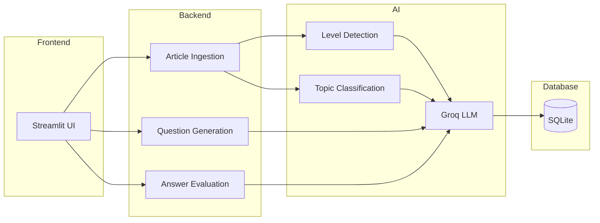

# 🇫🇮 YKI Reading AI Coach

An AI-powered web application that helps Finnish learners practice reading comprehension for the YKI (National Certificate of Language Proficiency) examination.

## Overview

YKI Reading AI Coach is an experimental project that combines Finnish reading materials with Large Language Models (LLMs) to support reading practice and question generation.

The goal is to make YKI reading preparation more interactive by automatically analyzing texts, identifying difficulty levels, and generating comprehension exercises.

## 1. System Workflow


## Current Features

✅ Import Finnish reading articles

✅ AI-based reading level detection

✅ Topic classification

✅ AI-generated reading comprehension questions

✅ Answer evaluation and feedback

✅ Streamlit web interface

## Technology Stack

### Frontend

- Streamlit

### Backend

- Python
- SQLite

### AI

- Groq API
- LangChain
- LLM-based content analysis

### Configuration

- Pydantic Settings
- Python Dotenv

## Project Structure

```text
YKI-Reading-AI-Coach/
│
├── frontend/
│   ├── app.py
│   └── views/
│
├── backend/
│   ├── config/
│   ├── database/
│   ├── functions/
│   └── llms/
│
├── data/
├── requirements.txt
└── README.md
```

## Installation

### Clone Repository

```bash
git clone https://github.com/THANH0201/YKI-Reading-AI-Coach.git
cd YKI-Reading-AI-Coach
```

### Create Virtual Environment

```bash
python -m venv venv
```

### Activate Environment

Windows:

```bash
venv\Scripts\activate
```

Linux/macOS:

```bash
source venv/bin/activate
```

### Install Dependencies

```bash
pip install -r requirements.txt
```

## Environment Variables

Create a `.env` file in the project root:

```env
GROQ_API_KEY=your_groq_api_key
```

## Run Application

```bash
streamlit run frontend/app.py
```

or

```bash
python -m streamlit run frontend/app.py
```

The application will be available at:

```text
http://localhost:8501
```

## Deployment

The application can be deployed using Streamlit Community Cloud.

### Main File

```text
frontend/app.py
```

### Required Secret

```toml
GROQ_API_KEY="your_api_key"
```

## Live Demo

🌐 https://yki-ai-coach.streamlit.app/

## Roadmap

Planned improvements:

- Improve question generation quality
- User authentication
- Reading history and practice tracking
- PostgreSQL support
- Additional YKI skill areas (Listening and Writing)
- Personalized learning recommendations

## Status

🚧 Work in Progress

This project is currently under active development and serves as a prototype for AI-assisted YKI reading practice.

